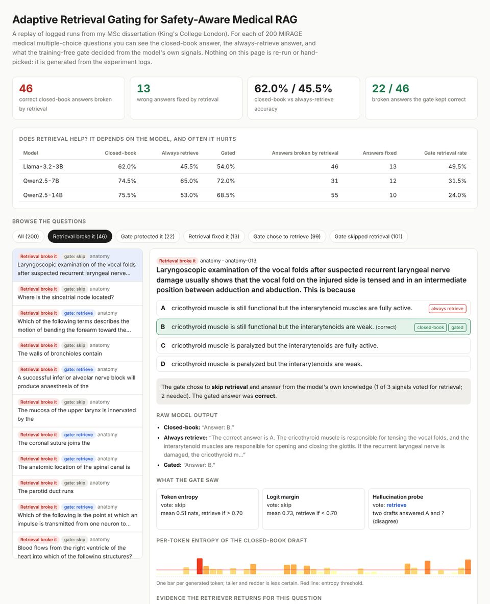

# Adaptive Retrieval Gating for Safety-Aware Medical RAG

MSc Artificial Intelligence dissertation (7CCSMPRJ), King's College London.
Tharit Mohamed Hussain Khan (22058691).

**[Replay demo](https://ideapersie.github.io/FinalProject_KCL/demo/)**: browse all 200 evaluation questions and see, for each one, the closed-book answer, the always-retrieve answer, the gate's three signals and its decision, and the evidence the retriever returned. It is generated from the experiment logs, needs no model, and runs in any browser. The live Gradio demo is in [section 8](#8-demo-interface).

[](https://ideapersie.github.io/FinalProject_KCL/demo/)

A medical question-answering system that decides **per query** whether to retrieve,
using only signals the language model already emits while generating. The gate is
training-free: no fine-tuning, no labelled "should-retrieve" data, and no second
model. The whole system is built to run offline on a commodity laptop with no GPU.

The motivating finding is that retrieval is not a free safety net. On multiple-choice
medical questions, injecting retrieved context **broke 46 previously-correct answers
and fixed only 13** on a quantised 3B model. Scale does not make the problem go away:
at 14B retrieval broke 55 and fixed 10. Selective retrieval is therefore studied as
*protection*, not as a cost optimisation.

## Results at a glance

200 MIRAGE-MMLU questions, MedRAG textbooks + 300K PubMed abstracts (425,847 chunks), BM25 + dense retrieval fused with RRF.

| Model | Closed-book | Always retrieve | Gated | Broken by retrieval | Fixed by retrieval | Gate retrieval rate |
|---|---|---|---|---|---|---|
| Llama-3.2-3B (Q4, CPU) | 62.0% | 45.5% | 54.0% | 46 | 13 | 49.5% |
| Qwen2.5-7B | 74.5% | 65.0% | 72.0% | 31 | 12 | 31.5% |
| Qwen2.5-14B | 75.5% | 53.0% | 68.5% | 55 | 10 | 24.0% |

At every scale the gate recovers between half and three quarters of the accuracy that always-retrieving throws away. At 3B it kept 22 of the 46 answers that retrieval broke. On open-ended questions the sign flips and retrieval helps (token F1 0.211 against 0.190 closed-book), which is why the decision has to be made per query. The table is recomputed from `results/raw_logs/` by `scripts/export_replay.py`.

## How the gate decides

The model first writes a short closed-book draft. Three signals are read off that draft, and retrieval runs only if at least two vote for it:

| Signal | Votes to retrieve when |
|---|---|
| Token entropy | mean per-token entropy of the draft is above a threshold |
| Logit margin | mean gap between the top two token probabilities is below a threshold |
| Hallucination probe | the same question framed two different ways gets two different answers |

A central finding of the dissertation is calibration: with thresholds taken from the literature, the two logit gates never fire on a small quantised model (its entropy peaks at 1.59 nats against a >2.5 threshold), so the probe is the only signal that votes. With model-specific thresholds, used for the runs in the table, all three signals vote: at 3B the entropy gate voted to retrieve on 104 of 200 questions and the margin gate on 107. The per-model configs are in `configs/policies/` and `results/raw_logs/p5_gated_*.yaml`.

---

## 1. What is in this archive, and what you must fetch

This repository is ~30 MB. The full working environment is ~6.6 GB. The difference
is deliberate: **everything omitted can be re-downloaded or rebuilt from public
sources using the commands below.** The one exception is the raw run logs, which are
included precisely because they cannot be regenerated without re-running every
experiment.

| Artifact | Size | Ships? | How to obtain |
|---|---|---|---|
| Source, configs, tests, report | ~2 MB | yes | included |
| `results/raw_logs/`, the experimental record | 14 MB | **yes** | not reproducible without re-running everything (~15 h) |
| `results/tables/`, `results/figures/` | 14 MB | yes | regenerate with the scripts in §5 |
| `data/raw/`, the MIRAGE and PubMedQA question sets | 4 MB | yes | `scripts/download_datasets.py` |
| `models/`, the GGUF weights | 1.9 GB+ | no | HuggingFace download (§3.2) |
| `data/corpora/medcorp_tp.jsonl`, 425,847 chunks | 413 MB | no | `scripts/build_medcorp.py` (§3.3) |
| `indexes/`, FAISS and BM25 | 2.4 GB | no | built by the same command (§3.3) |

Because the run logs are included, **you can regenerate and verify every number,
table and figure in the dissertation without downloading a model or building the
corpus at all** (§5). You only need the large artifacts to run *new* experiments.

---

## 2. Requirements

- Python 3.10 or newer
- ~8 GB RAM for the 3B model on CPU; ~10 GB free disk for the corpus and indexes
- No GPU required. The 7B and 14B scaling runs were executed on a Colab T4
  (`notebooks/colab_scaling.ipynb`); everything else runs CPU-only.

```bash
python -m venv .venv
source .venv/bin/activate        # Windows: .venv\Scripts\activate
pip install -r requirements.txt
pip install -e ".[dev]"
```

`llama-cpp-python` compiles against your CPU. For a faster build with BLAS:

```bash
CMAKE_ARGS="-DLLAMA_BLAS=ON -DLLAMA_BLAS_VENDOR=OpenBLAS" pip install llama-cpp-python
```

`scripts/setup_environment.sh` automates the above on Linux/macOS, including the
3B model download.

---

## 3. Rebuilding the large artifacts

Only needed to run new experiments. Skip to §5 to reproduce the reported results.

### 3.1 Question sets

```bash
python scripts/download_datasets.py
```

Fetches MIRAGE's `benchmark.json` and PubMedQA (`pqa_labeled`) into `data/raw/`.
Both are already included in this archive; the script is idempotent and will skip
them.

### 3.2 Models

The 3B baseline (CPU):

```bash
python -c "from huggingface_hub import hf_hub_download; \
hf_hub_download(repo_id='bartowski/Llama-3.2-3B-Instruct-GGUF', \
filename='Llama-3.2-3B-Instruct-Q4_K_M.gguf', local_dir='models/')"
```

The scaling models, only if you intend to reproduce the 7B/14B arms (GPU
recommended). `configs/models/qwen7b.yaml` and `qwen14b.yaml` expect these exact
paths:

- `models/qwen2.5-7b-instruct-q4_k_m.gguf`, from `bartowski/Qwen2.5-7B-Instruct-GGUF`
- `models/qwen2.5-14b-instruct-q4_k_m.gguf`, from `bartowski/Qwen2.5-14B-Instruct-GGUF`

All three are held at `Q4_K_M` on purpose: varying quantisation across scales would
confound "bigger model" with "less aggressively quantised model".

> **Filename note.** `configs/base.yaml` defaults to
> `models/llama-3.2-3b-q4_k_m.gguf`, but the reported runs passed the downloaded
> filename explicitly via `--model`. Either rename the file to match the config or
> keep passing `--model`, as the commands below do.

### 3.3 Corpus and indexes

```bash
python scripts/build_medcorp.py --sources textbooks pubmed \
  --limit-pubmed 300000 --name medcorp_tp
```

Downloads the MedRAG textbooks corpus plus a 300,000-passage PubMed slice, embeds
every chunk with `all-MiniLM-L6-v2`, and writes:

- `data/corpora/medcorp_tp.jsonl`, 425,847 chunks
- `indexes/faiss_medcorp_tp/`, an exact `IndexFlatIP`
- `indexes/bm25_medcorp_tp.pkl`

This is the long pole: expect several hours on CPU, dominated by embedding. The
build is **resumable**: it checkpoints every 2,000-chunk shard, so an interrupted
run continues where it stopped. Use `--stage {download,embed,assemble}` to run one
phase at a time.

StatPearls is absent from the corpus because the sub-corpus was unavailable on the
hosting hub at build time; this is recorded as a limitation in the dissertation.

---

## 4. Running experiments

Every experiment is one policy over one dataset. Configuration is layered YAML,
deep-merged in increasing precedence: `base` then `hardware` then `model` then
`policy` then `experiment`.

```bash
python scripts/run_experiment.py \
  --policy      configs/policies/p5_gated_entropy.yaml \
  --experiment  configs/experiments/mirage_p5_calibrated.yaml \
  --hardware    configs/hardware_medium.yaml \
  --dataset     data/raw/mirage/benchmark.json \
  --model       models/Llama-3.2-3B-Instruct-Q4_K_M.gguf \
  --bm25-index  indexes/bm25_medcorp_tp.pkl \
  --faiss-index indexes/faiss_medcorp_tp \
  --retrieval-mode hybrid --max-questions 200 \
  --output      results/raw_logs/p5_medcorp_mcq.jsonl
```

The policies (`configs/policies/`):

| Policy | Behaviour |
|---|---|
| P1 | always retrieve; the conventional RAG baseline and cost ceiling |
| P2 | always retrieve, with source citations (implemented, not evaluated; see dissertation §3.2) |
| P3 | closed-book; never retrieves; the parametric-knowledge reference and cost floor |
| P4 | always retrieve via hybrid rank fusion (RRF) |
| P5 | **gated**: the proposed method; consults the three-gate ensemble per query |

Runs are **resumable and deterministic**: output is append-only JSONL keyed by
`question_id`, so re-running skips completed questions, and greedy decoding at a
fixed seed reproduces logged answers exactly. `scripts/run_overnight.bat` wraps the
full 3B queue, relaunching each step until its log holds all 200 records.

Approximate 3B CPU cost per 200-question run: P1 ≈ 1.5 h, P3 ≈ 3 h, P5 ≈ 8.5 h
(the gate issues three extra draft generations per query).

Before any long run, smoke-test the model:

```bash
python scripts/smoke_test_model.py --model-config configs/models/qwen7b.yaml \
  --dataset data/raw/mirage/benchmark.json -n 4
```

### Scaling runs (7B / 14B)

`notebooks/colab_scaling.ipynb` runs the identical pipeline on a Colab T4. Only the
model file, its chat format and the calibrated gate thresholds change; the policy
and gate code are untouched, which is what makes the scaling comparison valid.

---

## 5. Reproducing the reported results

**This works from a fresh clone with no model, corpus or index**, because it reads
the committed run logs.

```bash
python scripts/generate_tables.py     # -> results/tables/*.tex + numbers.tex
python scripts/generate_figures.py    # -> results/figures/*.pdf + *.png
```

No number in the dissertation is hand-written. Every one is a LaTeX macro in
`results/tables/numbers.tex`, generated from the raw logs, and a regression test
fails the build if any reported value drifts from what the logs produce:

```bash
python -m pytest tests/regression -q
```

Offline analyses, all replayed from logs without invoking the model:

```bash
python scripts/run_threshold_sweep.py      # gate calibration sweep
python scripts/run_gate_ablation.py        # signal agreement / swing analysis
python scripts/run_gate_variants.py        # alternative voting rules
python scripts/analyse_chunk_relevance.py  # distraction study
```

---

## 6. Tests

```bash
python -m pytest -q
```

The suite runs in ~100 seconds with **no model or dataset download required**: a
mock backend supplies deterministic text and synthetic logit distributions.
Coverage spans configuration merging, retrieval ranking and index round-trips,
every gate's threshold and abstain behaviour, ensemble voting and degraded-mode
fallback, scoring, and the resumable run driver.

The drift-guard test skips rather than fails when `results/raw_logs/` is absent, so
confirm it actually ran if you are verifying reported numbers.

---

## 7. Building the dissertation

```bash
cd report
latexmk -pdf main.tex
```

Chapters are in `report/chapters/`; generated tables and figures are pulled in from
`results/`. The bibliography is `report/references.bib`.

---

## 8. Demo interface

```bash
python scripts/run_demo.py
```

A Gradio interface that answers a question under both the gated policy and
closed-book, showing what retrieval bought: the gate's decision with every
member's signal, threshold and vote, a draft-token entropy heatmap, and term
highlighting over retrieved chunks. Four preset questions (two the logged run
skipped, two it retrieved on) sit under the Run button.

Answers appear as three columns, P5 against P3 against the correct answer, over
a strip that is green only when **both** policies picked the gold letter, amber
when they split, and red when both missed. Two identical wrong answers are not
scored as agreement. The gold letter is optional: leave it blank and nothing is
scored, because a live demo has no ground truth unless it is supplied.

The model path, `indexes/bm25_medcorp_tp.pkl` and `indexes/faiss_medcorp_tp` are
all defaulted, so no flags are needed; `--model`, `--bm25-index` and
`--faiss-index` override them. Without the indexes the gate still runs and the
SKIP path still answers, but RETRIEVE reports the load error instead of evidence.

The demo runs at `--threads 12 --n-batch 512 --max-new-tokens 64`, well above the
`hardware_medium` evaluation tier the reported latencies were measured on. None
of the three affects a gate signal (the draft is greedy and its length is fixed
by `gate.draft_max_tokens`), so the verdicts match the logged run. Measured on
the 16-core development laptop, against the ~154 s median of the logged
evaluation run:

| stage | time |
|---|---|
| startup (model + both indexes + warm-up) | ~9 s |
| a question the gate skips | ~21 s |
| a question the gate retrieves on | ~60 to 95 s |

The retrieval path is slower because it adds the FAISS and BM25 lookups and then
answers over five retrieved chunks. Lowering **top-k** in Settings shortens that
prompt; it is left at the 5 the reported runs used.

Screenshots of all three panels are in `results/figures/demo/`.

### Static replay

`docs/demo/index.html` is a single self-contained page (no model, no server) that replays the logged 3B runs:

```bash
python scripts/export_replay.py          # rebuild docs/demo/index.html from results/raw_logs/
```

It joins P3 (`p3_mirage200.jsonl`), P1 with retrieved chunks (`p1_medcorp_mcq_chunks.jsonl`) and P5 (`p5_medcorp_mcq.jsonl`) on question ID, recomputes the headline counts, and inlines everything into `docs/demo/template.html`. To host it, enable GitHub Pages for this repository from the `main` branch, `/docs` folder; the page is then served at `/demo/`.

---

## 9. Repository layout

```
src/medrag_adaptive/    package: config, retrieval, gating, policies, evaluation
configs/                layered YAML: base, hardware tiers, models, policies, experiments
scripts/                data prep, corpus/index builds, experiment runner, analyses
tests/                  model-free unit, integration and regression tests
results/raw_logs/       the experimental record (input to every reported number)
results/tables/         generated LaTeX tables + numbers.tex macros
results/figures/        generated figures (PDF + PNG)
report/                 dissertation source (LaTeX)
notebooks/              Colab notebook for the 7B/14B scaling runs
docs/                   supplementary notes; docs/demo/ is the static replay demo
```

---

## 10. Licence and data provenance

Code is released under the licence in `LICENSE`. The corpora and benchmarks are
third-party research datasets, used here under their own terms and **not
redistributed** in this archive; they are downloaded from source by the scripts
above:

- **MIRAGE / MedRAG** (Xiong et al., 2024): benchmark and corpora
- **PubMedQA** (Jin et al., 2019): open-ended question set
- **Llama 3.2** (Meta) and **Qwen2.5** (Alibaba): model weights, under their
  respective licences

No patient data was processed at any point in this project. All sources are public
research datasets and published literature.
